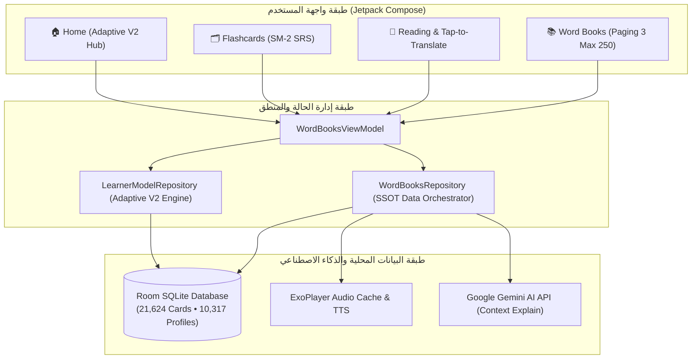

<div align="center">


# 📖 قاف | Qaf
### The Intelligent English Learning Platform • منصة تعلّم وممارسة الإنجليزية الذكية

[-3DDC84.svg?logo=android&logoColor=white)](#)
[](#)
[](#)
[-orange.svg)](#)
[](#)
[](https://github.com/Mhdibrahim01/Qaf/releases/latest)
[](#)

<p align="center">
  <b>قاف (Qaf)</b> هو تطبيق أندرويد متكامل وشامل لتعلّم وإتقان اللغة الإنجليزية للمتحدثين بالعربية، يجمع بين قوة <b>محرك التعلّم التكيفي (Adaptive V2)</b>، وخوارزميات <b>التكرار المتباعد (SuperMemo SM-2)</b>، ومكتبة ضخمة تضم <b>21,624 بطاقة استذكار</b> موزعة على 13 حقيبة تخصصية، وقاموس أوفلاين فوري يضم <b>10,317 كلمة مشروحة تفصيلياً</b>، مع نصوص قراءة متدرجة وقواعد تفاعلية مدعومة بالذكاء الاصطناعي.
</p>

[📥 تحميل ملف الإصدار المباشر (Download APK v2.0.0)](https://github.com/Mhdibrahim01/Qaf/releases/latest) • [✨ مميزات الإصدار 2.0](#-أبرز-مميزات-الإصدار-20--adaptive-v2-features) • [📚 الحقائب المتوفرة](#-الحقائب-والمجموعات-المتوفرة-13-decks--21624-cards) • [🏗️ البنية المعمارية](#️-البنية-البرمجية-والمعمارية--architecture--tech-stack) • [🛠️ طريقة البناء](#-كيفية-بناء-التطبيق-وتشغيله-build--run) • [📋 سجل الإصدارات](CHANGELOG.md)

</div>

---

## 🌟 أبرز مميزات الإصدار 2.0 • Adaptive V2 Features

### 1. 🧠 محرك التعلّم التكيفي الذكي (Adaptive V2 Engine)
- **دورة حياة المفردات خماسية المراحل (5-Stage Vocabulary Lifecycle)**:
  - تتبع دقيق لكل كلمة يتعلمها المستخدم عبر 5 مراحل علمية:
    $$\text{NEW} \longrightarrow \text{SEEN} \longrightarrow \text{LEARNING} \longrightarrow \text{MATURE} \longrightarrow \text{CONQUERED}$$
- **المخطط اليومي الذكي (Dynamic Daily Study Planner)**:
  - جدولة يومية آلية تعتمد على أولويات رباعية ذكية:
    1. **بطاقات الانتكاس (Lapsed / Again)**: إعادة التدريب العاجل للكلمات المتعثرة.
    2. **المسار السريع (Fast-track)**: كلمات جديدة محسوبة بدقة حسب معدل استيعابك.
    3. **المراجعة المجدولة (Scheduled Review)**: بطاقات مستحقة حسب فترات خوارزمية SM-2.
    4. **البدء الهادئ (Cold Start)**: وتيرة متدرجة ومريحة للمستخدم الجديد لتفادي التراكم.
- **التعليم المسبق للكلمات قبل القراءة (Story Pre-teaching)**:
  - فحص نصوص القراءة واستخراج الكلمات غير المألوفة للمتعلم لتسهيل قراءتها واستيعابها أولاً.
- **كشف الكلمات الصعبة وكراس الأخطاء (Leech Detection & Remediation)**:
  - حصر الكلمات كثيرة الخطأ تلقائياً في كراس خاص مع تدريبات مخصصة لعلاج التعثر.
- **رادار جاهزية المستويات الأوروبية (CEFR Readiness Radar)**:
  - قياس بياني لحظي لمدى جاهزيتك اللغوية في كل مستوى من مستويات الإطار الأوروبي ($A_1 \to C_1$) بناءً على المفردات المتقنة في الذاكرة طويلة المدى.

---

### 2. ⚡ أداء فائق وسلاسة تامة (60/120 FPS Performance Engine)
- **عزل عمليات إعادة الرسم (Fine-Grained Recomposition Isolation)**:
  - استخدام `derivedStateOf` والدوال غير القابلة للتغيير لمنع إعادة رسم الشاشات المعقدة أثناء التمرير وتقليب البطاقات.
- **إدارة ذكية ومحددة للذاكرة (Paging 3 Memory Bounds)**:
  - تحديد سقف ذاكرة التخزين المؤقت لقوائم الكلمات عند **250 عنصراً كحد أقصى** في الذاكرة النشطة، مما يقضي تماماً على انهيارات الذاكرة (OutOfMemory) في الهواتف المتوسطة والضعيفة.
- **استعلامات Room SQLite فائقة السرعة**:
  - فهارس تغطية مخصصة (Covering Indexes) وعمليات تحديث جماعية مدمجة تضمن استجابة قاعدة البيانات بأقل من 5 ميلي ثانية.

---

### 3. 🎨 هوية بصرية عصرية ثنائية اللغة (Modern Bilingual Identity)
- **شعار وأيقونة تكيفية فريدة**:
  - تصميم انسيابي يدمج حرف **Q** اللاتيني مع حرف **ق** العربي في شريط متصل ونقطتين ماسيتين متألقتين.
  - ألوان ملكية مستوحاة من سواد الليل الكحلي (Obsidian Navy `#0B0F17`) وبريق الذهب المشع (`#F59E0B`).
  - دعم كامل للأيقونات المتكيفة (Adaptive Icons) وأيقونة أحادية اللون (Monochrome) المتناغمة مع ثيم نظام أندرويد 13+ (Material You Dynamic Theming).

---

### 4. 🗂️ بطاقات استذكار متباعد علمي (SuperMemo SM-2 Flashcards)
- تطبيق دقيق لخوارزمية **SuperMemo SM-2** لجدولة فترات المراجعة الزمنية (`Again`, `Hard`, `Good`, `Easy`).
- تصميم بطاقات تكتيكي محسن للوجه والظهر بتباين لوني عالي ومريح للعين مع تأثيرات قلب ثلاثية الأبعاد بـ 60/120 إطاراً في الثانية.
- دعم النطق الصوتي الفوري الصافي (US/UK) مع وضع "السلحفاة" (Turtle Mode 0.7x) لتفكيك مخارج الحروف.

---

### 5. 📖 قراءة متدرجة وقاموس فوري (Graded Reading & 10,317 Offline Profiles)
- **قراءة تفاعلية لمستويات CEFR A1–C1**:
  - نصوص ومقالات باللغة الإنجليزية مقسمة حسب المستوى ومرفقة بأسئلة فهم واستيعاب.
  - **الضغط المباشر على أي كلمة:** استعراض معناها العربي، تفريغها الصوتي (IPA)، وتقطيع مقاطعها فوراً دون مغادرة النص.
  - **مساعد الذكاء الاصطناعي (Gemini AI Context Explanation):** شرح سياقي موجز ودقيق للكلمة داخل الجملة بنقرة زر واحدة.
- **قاموس أوفلاين مدمج وفوري (100% Offline)**:
  - 10,317 كلمة تفصيلية تشمل المتلازمات اللفظية (Collocations)، المشتقات، والتأصيل اللغوي (Etymology).

---

## 📚 الحقائب والمجموعات المتوفرة (13 Decks • 21,624 Cards)

| الحقيبة (Deck) | المستوى / الفئة | عدد البطاقات | الوصف والمحتوى |
| :--- | :--- | :---: | :--- |
| **Oxford 5000 (Parts 1, 2, 3)** | CEFR A1 – C1 Core | **5,948** | الكلمات الإنجليزية الأساسية الأكثر شيوعاً واستخداماً عالمياً |
| **Oxford OPAL (Academic)** | Academic English | **2,096** | مفردات أكسفورد الأكاديمية للدراسات الجامعية والأبحاث |
| **Oxford Phrasal Verbs** | General Fluency | **750** | أهم الأفعال المركبة شائعة الاستخدام في الحديث اليومي |
| **Essential Idioms** | Idiomatic English | **468** | أشهر التعابير الاصطلاحية والأمثال الإنجليزية |
| **Everyday Expressions** | Conversational English | **600** | التعبيرات اليومية والمحادثات الواقعية الشائعة |
| **IELTS Core Vocabulary** | Exam Preparation | **3,575** | المفردات الأساسية والمتقدمة لاجتياز اختبار الآيلتس |
| **PTE Academic Advanced** | Exam Preparation | **2,651** | مفردات اختبار بيرسون الأكاديمي المعتمدة |
| **CEFR C1 Advanced** | Advanced Mastery | **1,853** | مفردات المستوى المتقدم الاحترافي للطلاقة التامة |
| **IT & Tech Industry** | Industry-Specific | **1,622** | مصطلحات البرمجة وهندسة البرمجيات والذكاء الاصطناعي |
| **Business English** | Professional English | **1,250** | الإنجليزية المهنية وإدارة الأعمال والشركات والتفاوض |
| **Job Interview & Career** | Career Mastery | **406** | مصطلحات مقابلات العمل والتوظيف الدولي والعمل عن بعد |
| **Medical & Healthcare** | OET / PLAB Healthcare | **405** | المصطلحات الطبية والصحية ورعاية المرضى والأطباء |
| **المجموع الكلي** | **جميع التخصصات** | **21,624** | **تغطية شاملة لكل احتياجات متعلم اللغة الإنجليزية** |

---

## 🏗️ البنية البرمجية والمعمارية • Architecture & Tech Stack

يعتمد التطبيق على معمارية **Single Source of Truth (SSOT)** و **MVI / MVVM** مع فصل كامل للمسؤوليات:



### التقنيات الأساسية (Tech Stack):
- **لغة البرمجة**: 100% Kotlin حديثة ونظيفة مع Coroutines و Flow.
- **واجهة المستخدم**: Jetpack Compose + Material Design 3 مع دعم كامل للوضع المظلم (Dark Mode) وRTL/LTR ثنائي اللغة.
- **قاعدة البيانات**: Android Jetpack Room (SQLite) مع فهارس تغطية وعمليات مجمعة وتكامل مباشر مع Paging 3.
- **إدارة الذاكرة**: Jetpack Paging 3 مع قيود ذاكرة صارمة (`maxSize = 250`) لمنع تسرب الذاكرة.
- **الصوتيات**: Media3 ExoPlayer مع معالجة التخزين المؤقت المحلي ونظام TTS احتياطي.
- **الذكاء الاصطناعي**: Google Gemini API عبر اتصال سحابي آمن وموجز.

---

## 🛠️ كيفية بناء التطبيق وتشغيله (Build & Run)

### المتطلبات الأساسية (Prerequisites):
- تثبيت [JDK 17](https://adoptium.net/) أو أحدث.
- [Android Studio Ladybug / Meerkat](https://developer.android.com/studio) أو عبر سطر الأوامر باستخدام Gradle.
- Android SDK Platform 36 (minSdk 24).

### 1. استنساخ المستودع (Clone Repository):
```bash
git clone https://github.com/Mhdibrahim01/Qaf.git
cd Qaf
```

### 2. إعداد مفتاح الذكاء الاصطناعي (Gemini API Key - اختياري):
أنشئ ملف `.env` في المجلد الرئيسي وضع به مفتاح Gemini المجاني:
```properties
GEMINI_API_KEY="your_free_gemini_api_key_here"
```
*(ملاحظة: التطبيق يعمل أوفلاين بنسبة 100% بدون أي مفتاح، ويمكن أيضاً إدخال المفتاح يدوياً في أي وقت من شاشة الإعدادات داخل التطبيق).*

### 3. تشغيل الاختبارات الآلية (Run Unit & Robolectric Tests):
```powershell
.\gradlew.bat testDebugUnitTest
```

### 4. بناء ملف APK للتثبيت المباشر على الهاتف:
```powershell
.\gradlew.bat assembleRelease
```
*الملف الناتج ستجده في:* `app/build/outputs/apk/release/app-release.apk`

### 5. بناء حزمة المتجر (App Bundle - AAB):
```powershell
.\gradlew.bat bundleRelease
```
*الملف الناتج ستجده في:* `app/build/outputs/bundle/release/app-release.aab`

---

## 📱 التحميل المباشر (Direct APK Download)

يمكنك دائماً تنزيل أحدث ملف APK جاهز للتثبيت على هاتفك مباشرة عبر زيارة صفحة الإصدارات:
👉 **[Releases • تحميل التطبيق مباشرة](https://github.com/Mhdibrahim01/Qaf/releases)**

---

## 🗺️ التوثيق وخارطة الطريق (Documentation & Roadmap)
- [📋 سجل التغييرات الكامل (CHANGELOG.md)](CHANGELOG.md)
- [🗺️ خارطة الطريق والخصائص المستقبلية (ROADMAP.md)](ROADMAP.md)
- [📑 خطة المحرك التكيفي V2 (ADAPTIVE_V2_PLAN.md)](docs/ADAPTIVE_V2_PLAN.md)
- [🔍 تقرير تدقيق الجودة الشامل (ADAPTIVE_V2_AUDIT.md)](docs/ADAPTIVE_V2_AUDIT.md)

---

<div align="center">
صُمم وطُوّر بكل فخر وشغف لإثراء تجربة تعلّم اللغة الإنجليزية للمستخدم العربي 🚀<br>
<b>قاف • مفتاحك لإتقان الإنجليزية بلا قيود</b>
</div>
