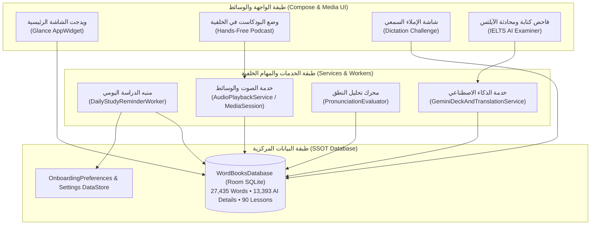

# 🗺️ قاف | Qaf — Comprehensive Feature Roadmap & Engineering Blueprint

This document serves as the self-contained, master engineering roadmap for **قاف (Qaf)**. Every feature is specifically architected to integrate seamlessly with Qaf's **Single Source of Truth (SSOT)** Room SQLite database (`WordBooksDatabase` + `WordBooksDao`), **60/120 FPS** Jetpack Compose UI layer, and **Obsidian Navy (`#0B0F17`) + Warm Gold (`#F59E0B`)** visual identity with bilingual RTL/LTR fidelity.

> 💡 **طريقة استخدام هذه الخريطة لاحقاً (How to Use This Roadmap Later)**:  
> كل ميزة في هذه الخريطة تحتوي على **"Quick-Start Prompt"** جاهز في نهايتها. عندما ترغب في البدء ببناء أي ميزة مستقبلاً، انسخ النص الموجود في صندوق الـ Prompt والصقه مباشرة في المحادثة لتبدأ عملية التنفيذ فوراً دون الحاجة لشرح التفاصيل مجدداً.

---

## 📊 جدول النظرة العامة على المراحل | Phased Priority Overview

| المرحلة | الميزة | الجهد المقدر | ركيزة التعلّم الأساسية | الاعتماديات البرمجية الأساسية | الحالة |
| :--- | :--- | :--- | :--- | :--- | :--- |
| **Phase 1A** | **Mistake Notebook & Weak-Words ("Leech") Drill** | ⚡ سريع | المعالجة الفورية للأخطاء والكلمات المتعثرة | Room SSOT (`again_count`, `correction_notebook`) | ✅ **منجز (v2.0)** |
| **Phase 1B** | **Smart Daily Study Reminders & Streak Freeze** | ⚡ سريع | بناء العادة اليومية وحماية السلسلة | `WorkManager`, `NotificationCompat`, DataStore | ⏳ قيد التخطيط |
| **Phase 2A** | **Interactive Listening & Dictation Challenges** | 🛠️ متوسط | دقة الاستماع والتهجئة والكتابة | Universal TTS, `SentencesScreen`, `quiz_results` | ⏳ قيد التخطيط |
| **Phase 2B** | **Android Home Screen "Word of the Day" Widget** | 🛠️ متوسط | التذكير المستمر والوصول السريع | Jetpack Glance (`glance-appwidget`), Room DAO | ⏳ قيد التخطيط |
| **Phase 3A** | **Hands-Free Vocabulary Podcast Mode** | 🛠️ متوسط | الاستماع أثناء القيادة والمشي والرياضة | `MediaSession`, Background Service, Lock Screen UI | 💡 موصى به أولاً |
| **Phase 3B** | **IELTS AI Writing & Speaking Examiner** | 🚀 متقدم | تقييم الآيلتس الرسمي وتقدير Band Score | Gemini AI 2.5 Flash, 9,386 IELTS Dataset, Grammar Link | 💡 جديد مقترح |
| **Phase 4A** | **Voice Pronunciation & Shadow Speaking Lab** | 🚀 متقدم | طلاقة التحدث ومخارج الحروف السليمة | Android `SpeechRecognizer`, Phonetic Matrix, Audio Record | ⏳ قيد التخطيط |
| **Phase 4B** | **Visual Lexical Mind-Map & Collocation Web** | 🛠️ متوسط | ربط المترادفات والمتلازمات اللفظية بصرياً | 13,393 AI Word Details, Compose Canvas / Force Graph | 💡 جديد مقترح |
| **Phase 4C** | **60-Second Vocabulary Blitz & Speed Quizzes** | ⚡ سريع | التنافسية وردة الفعل اللغوية السريعة | StateFlow Timer, Gamification Badge System | 💡 جديد مقترح |
| **Phase 5** | **Cloud Backup & Multi-Device Sync** | 🚀 متقدم | الحفاظ على البيانات ومزامنة الأجهزة المتعددة | Firebase Firestore + Google Sign-In (`CredentialManager`) | ⏳ قيد التخطيط (Local ✅) |

---

## 📐 الهيكلية المعمارية للترقية القادمة | Target System Architecture



---

## ⚡ المرحلة 1: بناء العادات والتذكير اليومي (Daily Habits & Consistency)

### الميزة 1B: منبه الدراسة الذكي ودرع حماية السلسلة (Smart Reminder & Streak Freeze)

#### 1. القيمة والفكرة التعليمية (Concept & User Value)
انقطاع يوم واحد بسبب الانشغال قد يحطم حافز المتعلم ويضيع سلسلة استمرارية امتدت لشهور. توفر هذه الميزة:
1. **درع تجميد السلسلة (Streak Freeze Shield 🛡️)** يحمي اليوم المفقود تلقائياً.
2. **إشعار تفاعلي سياقي** يظهر في وقت محدد يعرض كلمة واحدة مستحقة في جدول المراجعة مع إمكانية تعليمها كـ "متقنة" من شريط الإشعارات مباشرة دون فتح التطبيق.

#### 2. تجربة المستخدم والتصميم البصري (User Experience)
* **شارة الدرع في شريط العنوان**: أيقونة درع جليدي (`#38BDF8`) بجانب عداد السلسلة (`🛡️ x1` أو `🛡️ x2` بحد أقصى درعين).
* **آلية الحصول على الدرع**: يُمنح المستخدم درعاً تلقائياً عند إتمام **7 أيام دراسة متتالية**.
* **بانر الاستهلاك الذكي**: عند فتح التطبيق بعد يوم غياب، يظهر بانر طمأنينة أنيق: *"تم استخدام درع الحماية للحفاظ على سلسلتك اليومية البالغة X يوماً بنجاح!"*.
* **شكل الإشعار التفاعلي**:
  * العنوان: `قاف • وقت مراجعة الكلمات اليومية 📖`
  * النص: `كلمة مستحقة: Resilient (مرن / صامد) — اضغط للمراجعة السريعة`
  * الأزرار التفاعلية في الإشعار: `[ استمع 🔊 ]` و `[ حفظت الكلمة ✓ ]`.

#### 3. جدول البيانات وبنود التنفيذ التقني (Implementation Details)
* **المتغيرات في DataStore**:
  ```kotlin
  val STREAK_FREEZE_COUNT = intPreferencesKey("streak_freeze_count") // 0 to 2
  val LAST_PROTECTED_DATE = stringPreferencesKey("last_protected_date")
  val STUDY_REMINDER_ENABLED = booleanPreferencesKey("study_reminder_enabled")
  val STUDY_REMINDER_TIME_MINUTES = intPreferencesKey("study_reminder_time_minutes") // e.g. 20:00 -> 1200
  ```
* **ملف العامل الخلفي (`DailyStudyReminderWorker.kt`)**:
  * فحص جدول المهام اليومي `dao.getDailyTaskChecklist(todayDate)`.
  * إذا أتم المستخدم دراسته لليوم، يتم تخطي الإشعار لعدم الإزعاج.
  * إذا لم يتم، يتم جلب كلمة واحدة مستحقة (`is_due = 1`) وصياغة الإشعار بها عبر `NotificationCompat.Builder`.

> 💬 **Quick-Start Prompt to Build Feature 1B:**
> ```text
> Implement Phase 1B from ROADMAP.md: Smart Daily Study Reminders & Streak Freeze Shield.
> 1. Add streakFreezeCount (max 2) in OnboardingPreferencesRepository, awarding +1 shield every 7 continuous study days.
> 2. Auto-consume shield when a study day is missed so the streak counter doesn't reset.
> 3. Implement DailyStudyReminderWorker with WorkManager to send a daily interactive notification featuring a due SRS word with a "Mark Mastered" action button.
> ```

---

## 🛠️ المرحلة 2: دقة الاستماع والوجود الدائم على الشاشة (Listening & Widget Presence)

### الميزة 2A: تحديات الإملاء السمعي التفاعلي (Interactive Audio Dictation Mode)

#### 1. القيمة والفكرة التعليمية (Concept & User Value)
نقل مهارة المتعلم من "التعرف السلبي" (Passive Recognition) بمجرد النظر إلى "الاسترجاع النشط الفوري" (Active Recall & Spelling). يسمع المتعلم الجملة أو الكلمة منطوقة بصوت نقي، بينما النص الإنجليزي مخفي، وعليه كتابتها أو إعادة ترتيب كلماتها.

#### 2. تجربة المستخدم والتصميم البصري (User Experience)
* **شريط تحكم بالسرعة المزدوجة**: زر التشغيل الذهبي بالسرعة الطبيعية (`1.0x`)، وبجانبه زر السلحفاة المسطح الحديث (`0.60x`) لسماع مخارج الحروف والربط الصوتي (Connected Speech).
* **نمطان للتحدي**:
  1. **نمط المكعبات المبعثرة (Scrambled Word Tiles)**: مناسب للمستويات A1–B1؛ ترتيب كلمات الجملة عبر نقر مكعبات حركية ناعمة.
  2. **نمط الإملاء الحر للآيلتس (Full Keyboard Dictation)**: كتابة الجملة بالكامل عبر الكيبورد مع تلوين ذكي لحروف الخطأ:
     - أخضر: تطابق تام.
     - كهرماني: خطأ في حرف بسيط (Spelling typo).
     - أحمر مشطوب: كلمة منسية أو زائدة.

#### 3. التفاصيل التقنية (Technical Implementation)
* محرك المقارنة النصية `DictationEvaluator.kt`: استخدام خوارزمية **Levenshtein Distance** مع تجاهل حالة الأحرف (Case-insensitive) والفواصل والنقاط، وإرجاع نسبة دقة مئوية مع تمييز الحروف.

> 💬 **Quick-Start Prompt to Build Feature 2A:**
> ```text
> Implement Phase 2A from ROADMAP.md: Interactive Audio Dictation Mode.
> Add a "🎧 Dictation / إملاء سمعي" toggle in SentencesScreen and FlashcardsScreen with dual speed controls (1.0x and 0.6x), supporting both Scrambled Word Tiles and Full Keyboard input with real-time character-diff highlighting.
> ```

---

### الميزة 2B: ويدجت الشاشة الرئيسية لكلمة اليوم (Word of the Day Home Widget)

#### 1. القيمة والفكرة التعليمية (Concept & User Value)
ظهور الكلمات أمام عيني المتعلم كلما فتح قفل هاتفه دون الحاجة لفتح التطبيق، مما يحقق استرجاعاً عفوياً متكرراً (Spaced Passive Recall).

#### 2. تجربة المستخدم والتصميم البصري (User Experience)
* تصميم مدمج وأنيق متناسق مع هوية قاف الملكية:
  * خلفية زجاجية كحلية داكنة (`#0B0F17`).
  * الكلمة الإنجليزية بخط عريض ذهبي (`#F59E0B`).
  * الرمز الصوتي IPA، المعنى بالعربية، وجملة توضيحية قصيرة.
  * **الأزرار التفاعلية السريعة على الويدجت**:
    * `[ 🔊 استمع ]`: ينطق الكلمة عبر خدمة الصوت في الخلفية فورياً.
    * `[ 🔄 كلمة أخرى ]`: تدوير فوري لكلمة أخرى مستحقة من الحقائب المختارة.
    * `[ ✓ أتقنتها ]`: تحديث حالة الكلمة في قاعدة بيانات Room SQLite مباشرة والقفز للكلمة التالية.

#### 3. الاعتماديات البرمجية (Dependencies)
* مكتبة `androidx.glance:glance-appwidget` و `androidx.glance:glance-material3`.
* ملف الواصف: `res/xml/qaf_word_widget_info.xml`.

> 💬 **Quick-Start Prompt to Build Feature 2B:**
> ```text
> Implement Phase 2B from ROADMAP.md: Android Home Screen "Word of the Day" Widget using Jetpack Glance.
> Style the widget in Qaf's Obsidian Navy and Warm Gold theme, showing headword, IPA, Arabic translation, and example sentence with interactive buttons: Listen (TTS), Next Word, and Mark Mastered (synced directly with WordBooksDatabase).
> ```

---

## 🟣 المرحلة 3: الابتكارات الحصرية لقاف (Qaf Exclusive Innovations)

### الميزة 3A: وضع "البودكاست والاستماع أثناء التنقل" (Hands-Free Podcast Mode) 🎧

#### 1. القيمة والفكرة التعليمية (Concept & User Value)
معظم المتعلمين يضيع منهم وقت طويل أثناء المشي، قيادة السيارة، أو الرياضة. هذا الوضع يحول مفردات وقصص تطبيق "قاف" إلى إذاعة تعليمية متصلة تعمل في الخلفية بدون الحاجة للنظر إلى الشاشة إطلاقاً.

#### 2. تسلسل الدورة الصوتية للكلمة (Audio Learning Loop)
لكل كلمة في الحقيبة أو الكلمات المستحقة لليوم، يتم التشغيل التلقائي المتتابع كالتالي:
```
1. نطق الكلمة بالإنجليزية (بالسرعة الطبيعية 0.85x)
2. صمت لمدة ثانية واحدة (لإتاحة فرصة التفكير للمتعلم)
3. نطق المعنى بالعربية (عبر محرك TTS العربي)
4. نطق الكلمة مجدداً بالسرعة البطيئة (0.60x) لإتقان مخارج الحروف
5. نطق جملة المثال الإنجليزية ➔ ترجمة الجملة بالعربية
6. الانتقال التلقائي للكلمة التالية مع تكرار دوري
```

#### 3. البنية المعمارية البرمجية (Architecture & MediaSession)
* **خدمة خلفية مستقلة (`QafPodcastPlaybackService.kt`)**: ترث من `androidx.media3.session.MediaSessionService`.
* **إشعار شاشة القفل (`MediaStyle Notification`)**:
  * صورة غلاف الحقيبة الحالية.
  * أزرار التحكم: `[ السابق ]` `[ إيقاف / تشغيل ]` `[ التالي ]` `[ تبديل سرعة 1.0x / 0.7x ]`.
  * دعم كامل لأزرار سماعات البلوتوث وأزرار عجلة القيادة في السيارة (Bluetooth Media Keys).

> 💬 **Quick-Start Prompt to Build Feature 3A:**
> ```text
> Implement Feature 3A from ROADMAP.md: Hands-Free Vocabulary Podcast Mode.
> Build a MediaSessionService that loops through a chosen deck or today's due words: pronouncing the English word, giving its Arabic meaning, slow pronunciation, and example sentence with full lock-screen notification controls and Bluetooth headphone buttons support.
> ```

---

### الميزة 3B: فاحص كتابة ومحادثة الآيلتس بالذكاء الاصطناعي (IELTS AI Examiner) 📝🎙️

#### 1. القيمة والفكرة التعليمية (Concept & User Value)
بعد دمج **9,386 كلمة آيلتس معتمدة** و **90 درساً شاملاً للقواعد** في الإصدار v2.1.0، تقدم هذه الميزة "مصححاً أكاديمياً ذكياً" لاختبار الآيلتس:
يكتب المستخدم مقاله (Task 1 أو Task 2) أو يُسجل إجابته الصوتية لأسئلة Speaking Part 2، ويقوم الذكاء الاصطناعي (Gemini 2.5 Flash) بفحص النص وتزويد المتعلم بتقرير مفصل وتقدير دقيق لعلامة الـ **Band Score**.

#### 2. محاور التقييم الأربعة الرسمية (Official IELTS Assessment Criteria)
1. **المخزون المعجمي (Lexical Resource)**:
   * فحص الكلمات المستخدمة ومطابقتها مع قاموس الـ 9,386 كلمة في التطبيق.
   * إبراز الكلمات المتقدمة (B2, C1, C2) بلون أخضر، واقتراح بدائل أكاديمية رسمية للكلمات المتكررة أو البسيطة (مثل استبدال *big* بـ *substantial* أو *considerable*).
2. **المدى القواعدي والدقة (Grammatical Range & Accuracy)**:
   * رصد الجمل البسيطة والمركبة والمعقدة.
   * **الميزة الحصرية**: عند وجود خطأ قواعدي، يظهر زر ينقل المتعلم مباشرة إلى **درس القواعد المرتبط في تطبيق قاف** لمراجعته فورياً!
3. **الاتساق والترابط (Coherence & Cohesion)**:
   * تقييم أدوات الربط والفقرات المنطقية.
4. **تحقيق المهمة (Task Achievement)**:
   * مدى الإجابة على السؤال والالتزام بعدد الكلمات المطلوب (150 كلمة لـ Task 1 و 250 كلمة لـ Task 2).

#### 3. واجهة المستخدم (Compose UI Flow)
* شاشة مخصصة `IeltsWritingLabScreen.kt` تحتوي على:
  * منتقي مواضيع الآيلتس الحديثة مع عداد كلمات لحظي (Live Word Count).
  * بطاقة النتيجة الدائرية الكبيرة: **Band Score (e.g. 7.0)**.
  * تفصيل النقاط الأربعة بمخطط راداري (Radar Chart) مع نصائح فورية لرفع الدرجة بمقدار نصف درجة (+0.5).

> 💬 **Quick-Start Prompt to Build Feature 3B:**
> ```text
> Implement Feature 3B from ROADMAP.md: IELTS AI Writing & Speaking Examiner.
> Create an IELTS preparation lab where users submit Task 1/2 essays or speaking transcripts. Call Gemini API to evaluate based on the 4 official IELTS criteria, calculate an estimated Band Score, highlight used IELTS vocabulary from our 9,386-word dataset, and link grammar errors directly to Qaf's 90 grammar lessons.
> ```

---

### الميزة 3C: الشبكة البصرية الذكية للمترادفات والمتلازمات (Visual Lexical Mind-Map) 🕸️

#### 1. القيمة والفكرة التعليمية (Concept & User Value)
العقل البشري يحفظ المفردات على شكل شبكات عصبية ومفاهيم مترابطة، وليس قوائم منفصلة. هذه الميزة تستغل الـ **13,393 تفصيلاً لغوياً** الموجودة في التطبيق لرسم خريطة بصرية تفاعلية تنبثق من الكلمة المختارة.

#### 2. بنية الخريطة البصرية (Mind-Map Nodes)
* **العقدة المركزية (Center Node)**: الكلمة المستهدفة (مثال: `acquire`).
* **الفروع المحيطة (Interactive Branches)**:
  1. *المترادفات (Synonyms)*: `obtain`, `gain`, `attain`.
  2. *المتضادات (Antonyms)*: `lose`, `forfeit`.
  3. *المتلازمات اللفظية الأكثر شيوعاً (Collocations)*: `acquire knowledge`, `acquire skills`, `acquire wealth`.
  4. *حروف الجر المرتبطة (Prepositions)*: `acquire from`.
* النقر على أي عقدة فرعية يشغل نطقها فوراً أو يفتح بطاقتها المستقلة.

> 💬 **Quick-Start Prompt to Build Feature 3C:**
> ```text
> Implement Feature 3C from ROADMAP.md: Visual Lexical Mind-Map.
> In WordDetailSheet, add an interactive visual graph using Compose Canvas that connects the target word to its synonyms, antonyms, and collocations parsed from our 13,393 AI word details, allowing one-tap pronunciation and navigation.
> ```

---

## 🚀 المرحلة 4: طلاقة التحدث والتحديات السريعة (Speaking & Gamification)

### الميزة 4A: مختبر التحدث ومحاكاة النطق (Shadow Speaking Lab) 🎙️

#### 1. القيمة والفكرة التعليمية (Concept & User Value)
تمكين المستخدم من التحدث وسماع صوته ومقارنته بنطق المتحدثين الأصليين، مع التركيز على معالجة المشاكل الصوتية الشائعة للمتحدثين بالعربية.

#### 2. مصفوفة مخارج الحروف الذكية (Arabic Phonetic Matrix)
تحليل النطق عبر `SpeechRecognizer` مع تركيز خاص على:
* التمييز بين `/p/` و `/b/` (مثل: *pat* vs *bat*).
* التمييز بين `/v/` و `/f/` (مثل: *van* vs *fan*).
* أصوات الثاء والذال `/θ/` و `/ð/` (مثل: *think* vs *sink*).
* إعطاء نصيحة مخارج الحروف بالعربية فورية: *"اجعل شفتيك مضمومتين دون خروج هواء لتفرقة صوت الـ B عن الـ P"*.

> 💬 **Quick-Start Prompt to Build Feature 4A:**
> ```text
> Implement Feature 4A from ROADMAP.md: Shadow Speaking Lab.
> Use Android SpeechRecognizer with RECORD_AUDIO permission to evaluate spoken words against target phonemes, highlighting correctly pronounced letters in green and missed letters in coral with targeted Arabic articulation tips for /p/ vs /b/ and /v/ vs /f/.
> ```

---

### الميزة 4B: تحدي الـ 60 ثانية السريع (60-Second Vocabulary Blitz) ⏱️⚡

#### 1. القيمة والفكرة التعليمية (Concept & User Value)
كسر رتابة الحفظ التقليدي عبر لعبة سريعة ومثيرة: أمامك 60 ثانية للإجابة على أكبر عدد ممكن من الكلمات (معنى صحيح / خاطئ، أو اختيار الترجمة الأدق).

#### 2. عناصر التلعيب والتشويق (Gamification)
* مؤقت دائري ناري ينبض بالألوان الذهبية والحمراء مع مؤثرات صوتية تحفيزية خفيفة.
* نظام نقاط متضاعف (Combo Multiplier): كل 5 إجابات صحيحة متتالية تضاعف النقاط (`2x`, `3x`).
* قائمة أعلى النتائج الشخصية (High Score) وشارات إنجاز جديدة:
  - 🥇 *قناص المفردات (Word Sniper)*: 25 إجابة صحيحة في دقيقة واحدة.
  - ⚡ *البرق الأكاديمي (Academic Lightning)*: 15 كلمة آيلتس صحيحة متتالية.

> 💬 **Quick-Start Prompt to Build Feature 4B:**
> ```text
> Implement Feature 4B from ROADMAP.md: 60-Second Vocabulary Blitz.
> Create a fast-paced gamified quiz mode with a 60-second animated timer, streak combo multipliers, sound effects, and high-score tracking integrated with Room database vocabulary entries.
> ```

---

## ☁️ المرحلة 5: المزامنة السحابية الكاملة (Cloud Sync & Multi-Device)

### الميزة 5: المزامنة السحابية بحساب Google (Firebase Firestore Cloud Sync)

#### 1. القيمة والفكرة التعليمية (Concept & User Value)
حماية تقدم المتعلم عند تغيير الهاتف أو المذاكرة بالتزامن بين الهاتف والتابلت دون الحاجة لإنشاء حساب يدوي أو تذكر كلمات مرور، باستخدام تسجيل الدخول الفوري بـ Google عبر `CredentialManager`.

#### 2. قواعد الأمان والبنية السحابية
* **تخزين الوثائق حسب معرّف المستخدم (Per-User Namespacing)**:
  `/users/{uid}/word_progress/{entryId}` و `/users/{uid}/profile/study_state`.
* **قواعد الحماية (Firestore Security Rules)**:
  لا يُسمح لأي جهاز بالقراءة أو الكتابة إلا داخل مجلد الـ `uid` الخاص به فقط (`request.auth.uid == userId`).
* **خوارزمية حل التعارضات (Conflict Resolution)**:
  دمج التواريخ بحسب التوقيت الأحدث (Last-Write-Wins)، واعتبار الكلمة المتقنة متقنة دائماً (Union of `isMastered = true`).

> 💬 **Quick-Start Prompt to Build Feature 5:**
> ```text
> Implement Feature 5 from ROADMAP.md: Firebase Firestore Cloud Sync with Google Sign-In.
> Use Android CredentialManager to authenticate with Google, syncing Room database tables (word_progress, study_plans, daily_task_checklist) with Firestore collections under /users/{uid}/ with offline persistence and deterministic Last-Write-Wins conflict resolution.
> ```

---

## 📌 جدول الترتيب الزمني المقترح للتنفيذ (Recommended Roadmap Schedule)

```
الإصدار القادم v2.2.0:
├── 1. ويدجت الشاشة الرئيسية (Home Screen Widget)
└── 2. وضع البودكاست والاستماع أثناء التنقل (Hands-Free Podcast Mode)

الإصدار v2.3.0:
├── 3. منبه الدراسة الذكي ودرع السلسلة (Smart Reminders & Streak Freeze)
└── 4. تحديات الإملاء السمعي (Interactive Audio Dictation)

الإصدار v2.4.0 (إصدار الآيلتس الكبير):
├── 5. فاحص مقالات ومحادثة الآيلتس بالذكاء الاصطناعي (IELTS AI Examiner)
└── 6. خريطة المترادفات والمتلازمات البصرية (Visual Lexical Mind-Map)

الإصدار v3.0.0:
├── 7. مختبر النطق والتحدث التفاعلي (Shadow Speaking Lab)
├── 8. مسابقة الـ 60 ثانية السريعة (60-Second Vocabulary Blitz)
└── 9. المزامنة السحابية مع حساب Google (Firebase Cloud Sync)
```

---
*تم إعداد هذه الخطة وتوثيقها لتكون المرجع الهندسي الشامل لتطوير تطبيق **قاف (Qaf)** في مراحله القادمة بنجاح واحترافية.*
